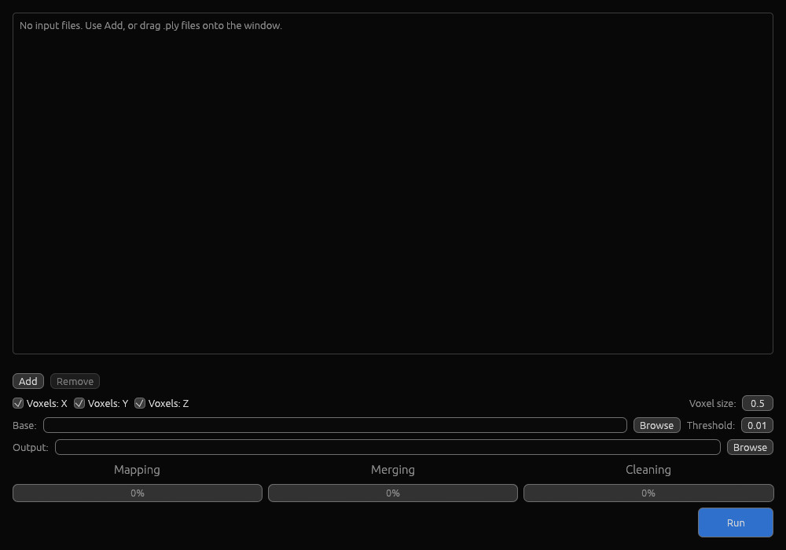
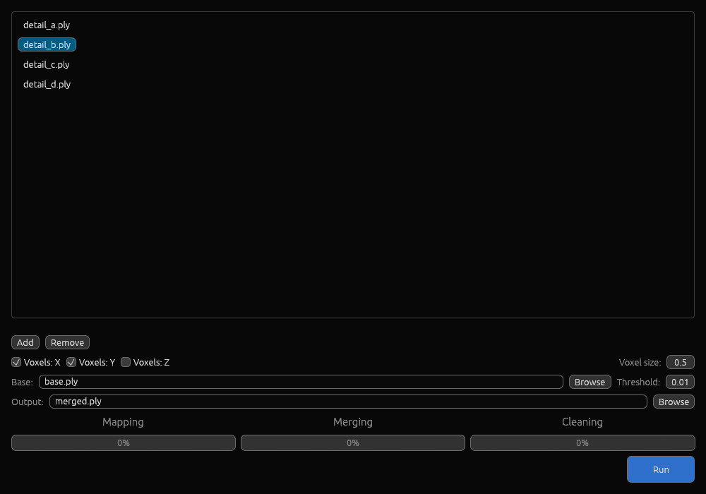
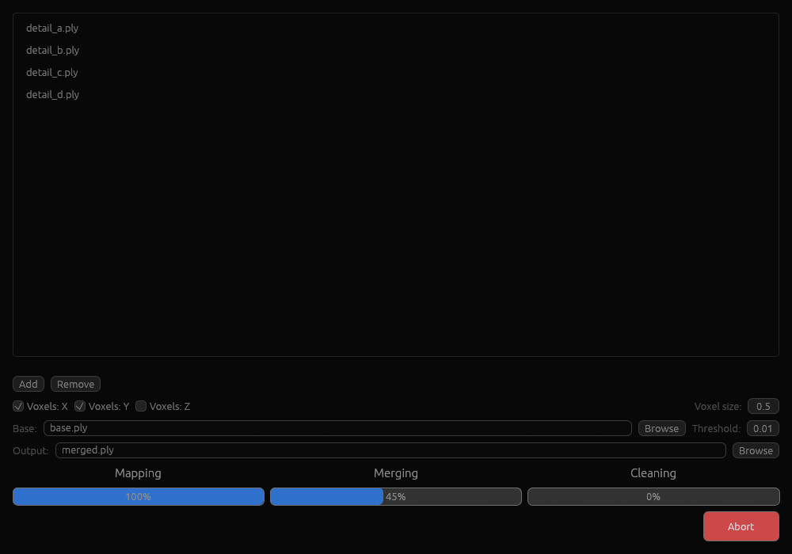

# Splat-Merge

A high-performance Rust tool to merge or filter 3D Gaussian Splatting `.ply` files.
It memory-maps its inputs (`memmap2`), so it handles multi-GB scenes on consumer
hardware (64 GB RAM optimized). You can drive it from the command line, or launch
the built-in GUI by running the binary without arguments.

> **Built with AI assistance**
> The initial core implementation was done with Gemini; the main part was
> then developed with Qwen, using Ollama and OpenCode, through interactive
> sessions with the user.

## Why this tool

This is a tool that I wanted to have to merge multiple splats. At some point I
found that 20 million splats were not representing the detail I wanted, but
tools like Brush could not train much more on my 24 GB VRAM. So I started to
train the same scene multiple times — always exporting different areas of poses
from RealityScan to COLMAP and training each set to 20M splats (at SH1).

This gets a total of many more splats, but it still requires an efficient way
to merge them. That's where this tool comes in:

1. **Voxel mode** merges the detail-area splats: the scene is cut into cubes
   (default 0.5 = 50×50×50 cm), and per cube all splats from the input that has
   the most splats in that cube are kept (ties go to the earliest input). One
   pass over the whole input list, and I end up with one large splat.

   Unfortunately, the merged splat contains floaters — typically occluded areas
   that one of the detail views could not see, so the trainer had no way to know
   they are empty. These floaters have one thing in common: they are rather big.

2. **Scale mode** removes them: I train a base scene (all poses at once, 20M
   splats — which I need for LOD anyway) and run the merge against it. The tool
   keeps all splats of the merged details that are smaller than a threshold and
   all splats of the base that are equal or bigger. The merged details first,
   the 20M base second — and the result is a clean, huge splat. The threshold
   that worked well for me was `0.01`.

## GUI

Running the binary **without arguments** opens the GUI (on Windows it is linked
with the GUI subsystem, so double-clicking starts the window without a console):

| | |
|---|---|
|  |  |
| *Idle: empty start, all voxel axes enabled, zero progress* | *Configured: four inputs (one selected), Z axis unchecked, base + output set, bars at 0%* |
|  | |
| *Running: Mapping done, Merging at 45%, controls disabled, red **Abort*** | |

What you can do in the window:

- **Add / Remove** input files (multi-select picker, or just drag & drop
  `.ply` files onto the window — other files are rejected).
- Choose which axes define the voxel cells with the **Voxels: X / Y / Z**
  checkboxes (all on by default; an unchecked axis is ignored, so the cells are
  extruded along it). This is a GUI feature — the CLI always merges on all
  three axes.
- Set the **voxel size**, the optional **base** file and the scale
  **threshold** (see the steps below), and pick the **output** file.
- Press **Run**. While a run is active the controls are disabled and the
  button turns into a red **Abort**; progress shows as a table with one bar
  each for **Mapping**, **Merging** and **Cleaning** (percentage inside each
  bar).
- Validation failures, rejected files, run errors and the final result appear
  as native message dialogs. If some properties are missing from some input
  files, a confirmation dialog names the properties that will be dropped from
  the output before the run starts.
- After a run (success, failure or abort) the settings are preserved, so a
  rerun is immediate.

## Features

- **Memory efficiency** — inputs are memory-mapped, never loaded fully into RAM;
  output is written through a buffered writer.
- **Voxel density merge** — all inputs in the list are compared per voxel in a
  single pass; per cube only the splats of the densest input are kept (ties go
  to the earliest input), so multi-file merges need no intermediate files.
- **Scale threshold filtering** — splits splats by their maximum world-space
  scale (the exponential of the stored log-scale), typically to drop floaters
  while keeping the base scene.
- **Binary accuracy** — the PLY header is reconstructed and property values are
  kept byte-exact; properties present in every non-empty input are preserved in
  the output, properties missing from some files are dropped with a
  notification (and confirmed first in the GUI).
- **Progress lines** — `1 Mapping`, `2 Merging (voxel based)` and
  `3 Cleaning (scale based)` are reported per million splats on stdout.
- **Run log** — every run writes a timestamped `splat-merge.log` next to the
  executable, kept even after failures or aborts.
- **Null inputs** — `-` as a filename treats an input slot as empty.

## CLI

| Flag | Meaning |
|---|---|
| `-i, --inputs <a,b,c>` | Comma-separated list of input PLY files; an entry may be `-` (empty) |
| `--base <file>` | Optional base PLY (file 2 of the scale step); omitted or `-` = no scale step |
| `-o, --output <file>` | Output PLY |
| `-v, --voxel-size <f>` | Cube edge length for the voxel step (default: `0.5`) |
| `-t, --threshold <f>` | Max-scale threshold for the scale step (default: `0.01`) |

### Voxel mode (density merge)

```bash
cargo run --release -- -i file1.ply,file2.ply -o merged.ply
```

### Scale mode (size merge)

The input(s) are file 1; the base is file 2.

```bash
cargo run --release -- -i file1.ply --base file2.ply -o merged.ply
```

### Typical workflow

All detail files can be merged with the base in a single command:

```bash
cargo run --release -- -i detail_a.ply,detail_b.ply,detail_c.ply,detail_d.ply --base base.ply -o merged.ply
```

Step by step:

```bash
cargo run --release -- -i detail_a.ply,detail_b.ply -o detail_ab.ply
cargo run --release -- -i detail_ab.ply,detail_c.ply,detail_d.ply -o detail_abcd.ply
cargo run --release -- -i detail_abcd.ply --base base.ply -o merged.ply
```

A single input without `--base` is a byte-identical passthrough copy.

## How it works

1. **Voxel step** (2+ inputs): space is divided into cubes of `--voxel-size`;
   per cube the input with the most splats wins — its splats in that cube are
   kept, the others' are dropped. Mapped once, merged in one pass, written to
   the output (or to a temporary file when a scale step follows).
2. **Scale step** (with `--base`): splats of the accumulated file with max
   world-scale **below** the threshold are kept together with all splats of
   the base whose max scale is **at or above** it. World-space scale is
   `exp(scale_n)`; splats are stored with three log-scale properties.
3. **Passthrough** (one input, no base): the file is copied verbatim.

Temporary files are always removed at the end of a run (success or error); on
an abort (GUI only) the partially written output is removed as well.

## Build

```bash
cargo build --release
```

The binary is a single executable: no arguments → GUI, any pipeline flags →
CLI, `--debug-render <state.json>` → deterministic GUI rendering for
verification (see the docs).

## Documentation

Full project documentation — modes, binary format rules, progress and run-log
line formats, architecture and test cases — lives in
[`docs/documentation.md`](docs/documentation.md).
